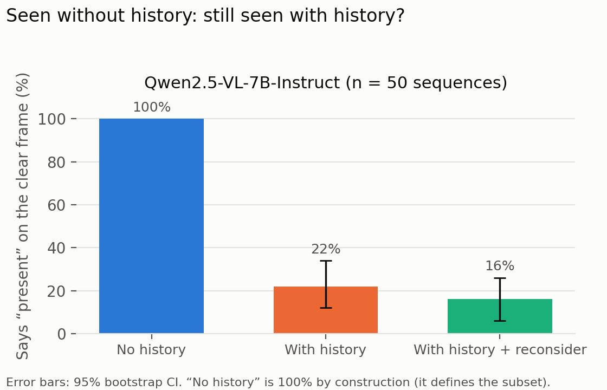

# Hallucinated Visual Belief Persistence in Sequential Autonomous Vehicle Perception

Course project for CMPE 249: IA Systems (Track 6, Safety and Evaluation).

**Team:** Nickzad Bayati, Toney Zhen

## Abstract

Vision-language models (VLMs) are increasingly used for perception and reasoning in autonomous systems, including vehicles. A model that forms an incorrect visual interpretation at one timestep may continue to rely on it even after later observations provide contradictory evidence. This project evaluates whether VLMs revise these incorrect interpretations over time or allow them to influence later scene understanding. Using sequential driving-image data, we examine object presence, attributes, spatial relationships, scene state, and other driving-relevant information. We compare stateful and stateless inference across Qwen2.5-VL and LLaVA-OneVision using metrics for hallucination persistence, correction latency, performance difference, and safety-action accuracy. The results will characterize when earlier visual errors persist and inform the evaluation of more reliable VLM components for safety-critical autonomous systems.

## Results

Both models keep saying "no pedestrian" after the pedestrian becomes clearly visible when they see
their own earlier answers (145 nuScenes sequences per model, 95% bootstrap CIs):

| | Qwen2.5-VL-7B (1024 px) | LLaVA-OneVision-7B (768 px) |
|---|---|---|
| Post-evidence accuracy, stateless → stateful | 38% → 9% | 84% → 65% |
| Stateful − stateless (paired) | −29 pts [−35, −23] | −18 pts [−25, −12] |
| Clear frames seen without history that are still seen with history | 22% [12, 34] of 50 | 73% [65, 81] of 119 |
| Answers identical to the previous answer, stateless / stateful | 31% / 84% | 37% / 93% |
| Reconsider vs plain stateful | no better | no better |



**Limitations:** no pedestrian-free control sequences (false positives unmeasured; LLaVA says
"present" on 52–59% of pre-evidence frames); rule-based action labels (92% "proceed"); different
image sizes per model to fit a T4; nuScenes visibility spans all six cameras and was not manually
reviewed; 107 LLaVA replies were a bare "No" with no action, counted as unsafe.

## Evaluation pipeline

`nuScenes sequence → VLM (stateless / stateful / reconsider) → answer parsing → metrics`

A sequence is 6 consecutive `CAM_FRONT` keyframes in which one pedestrian is first barely
visible (nuScenes visibility 0–40%) and later clearly visible (80–100% and at least 40 px tall,
the *evidence frame*). Before the evidence frame, no other pedestrian is clearly visible.
On v1.0-trainval metadata this yields 145 sequences (`--min-px 60` gives 81; mini gives 2). At each frame the model is
asked whether a pedestrian is present, plus a confidence, evidence and a driving action.

| Mode | What the model sees |
|---|---|
| `stateless` | only the current frame |
| `stateful` | the whole conversation, including its own earlier answers |
| `reconsider` | stateful, plus "judge only from this image" (the mitigation) |

Metrics (`belief_eval/metrics.py`, 95% bootstrap CIs): hallucination persistence rate (wrong just
before the evidence frame and still wrong one frame after it), correction latency (median / p90),
post-evidence accuracy and the paired stateful − stateless difference, accuracy on evidence frames
the model sees without history (isolates the effect of history from perception), safety-action balanced
accuracy and unsafe-action rate.

### Usage

Download nuScenes mini from <https://www.nuscenes.org/nuscenes#download> into `data/nuscenes`
(it must contain `v1.0-mini/` and `samples/`).

```bash
pip install -r requirements.txt
python -m belief_eval mine --dataroot data/nuscenes
python -m belief_eval run --dataroot data/nuscenes --model mock --limit 5   # dry run, no GPU
python -m belief_eval run --dataroot data/nuscenes --model Qwen/Qwen2.5-VL-3B-Instruct --4bit --out results_qwen.jsonl
python -m belief_eval score results_qwen.jsonl
python -m belief_eval figures results/*.jsonl --dataroot data/nuscenes   # PNGs in figures/
```

`run` appends to its output file and skips finished (sequence, mode) pairs, so an interrupted run
can be restarted with the same command.

Tests: `python -m unittest discover tests`

Image crops in `figures/examples_*.png` are from the nuScenes dataset (Motional), used under
CC BY-NC-SA 4.0 for non-commercial research: <https://www.nuscenes.org/terms-of-use>.
