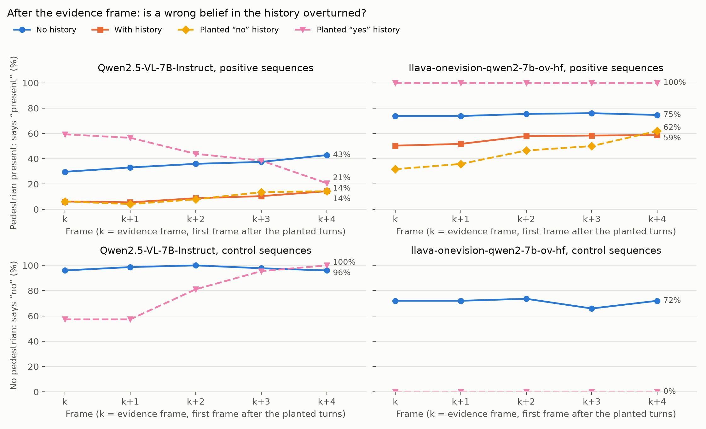

# Hallucinated Visual Belief Persistence in Sequential Autonomous Vehicle Perception

Course project for CMPE 249: IA Systems (Track 6, Safety and Evaluation), San José State University.

**Team:** Nickzad Bayati, Toney Zhen

- **Paper (PDF):** [report/main.pdf](report/main.pdf) (LaTeX source in [report/](report/))
- **Video demo:** _link to be added_
- **Models:** [Qwen/Qwen2.5-VL-7B-Instruct](https://huggingface.co/Qwen/Qwen2.5-VL-7B-Instruct), [llava-hf/llava-onevision-qwen2-7b-ov-hf](https://huggingface.co/llava-hf/llava-onevision-qwen2-7b-ov-hf) (used as released; no training or fine-tuning)
- **Dataset:** [nuScenes v1.0](https://www.nuscenes.org/nuscenes#download) (trainval metadata + camera keyframes)

## Abstract

Vision-language models (VLMs) are increasingly used as perception components in autonomous vehicles, where they are queried over a stream of camera frames.
We test whether a VLM that wrongly reports "no pedestrian" keeps that belief after the pedestrian becomes clearly visible.
On 145 nuScenes front-camera sequences in which a pedestrian goes from 0–40% to 80–100% visible, we query Qwen2.5-VL-7B and LLaVA-OneVision-7B on every frame without history (stateless), with the conversation history including their own earlier answers (stateful), and with history plus an instruction to reconsider.
History lowers post-evidence accuracy by 25 and 22 points, and the cause is answer copying.
The reconsider instruction does not help; only resetting the history does.
A fixed wrong "no" planted in the history suppresses detections just as strongly, and on 75 pedestrian-free control sequences a planted wrong "yes" persists too, so the failure is copying in either direction rather than a belief specific to absence.

## Results

| | Qwen2.5-VL-7B (1024 px) | LLaVA-OneVision-7B (768 px) |
|---|---|---|
| Post-evidence accuracy, stateless → stateful | 33% → 8% | 74% → 52% |
| Stateful − stateless (paired, 95% CI) | −25 pts [−32, −19] | −22 pts [−30, −14] |
| Clear frames seen without history that are still seen with history | 21% [9, 36] of 43 | 60% [50, 69] of 107 |
| … with a planted "no" history instead | 21% [8, 36] | 43% [32, 53] |
| Answers identical to the previous answer, stateless / stateful | 30% / 78% | 36% / 93% |
| Reconsider instruction vs plain stateful | no better | no better |
| Control frames called "present" without history | 1.6% | 31% |
| Empty frames called empty without history, still called empty after a planted "yes" | 57% [46, 68] of 72 (5% after 4 planted turns) | 0% of 54 |




**Limitations:** control sequences are run only without history and with a planted "yes"; rule-based driving-action labels (95% "proceed"); different image sizes per model to fit a 16 GB T4; nuScenes visibility spans all six cameras and was not reviewed manually; 750 of 2,610 LLaVA replies were a bare "Yes"/"No" with no action, and LLaVA's history effect is concentrated in the 47 sequences that start with a bare "No" (a format that depends on the question wording).
Details in section 5 of the paper.

## Project structure

```
belief_eval/            evaluation package (python -m belief_eval <command>)
  mine.py               mine sequences from the nuScenes JSON tables (no devkit needed)
  run.py                query a model over sequences in stateless / stateful / reconsider /
                        planted_no / planted_yes mode
  models.py             Hugging Face VLM wrapper (+ a scripted mock model for tests)
  metrics.py            metrics with bootstrap 95% CIs, incl. visible-without-history
  figures.py            figures as PNG (README) and vector PDF (paper)
  __main__.py           CLI: mine, mine-controls, run, score, figures
notebooks/
  colab_eval.ipynb      run a model on a Colab T4 (setup, smoke test, full run, scores)
results/                raw model answers, one JSON line per (sequence, mode)
figures/                generated figures (.png and .pdf)
report/                 LaTeX paper (IEEE conference format) and bibliography
tests/                  unit and end-to-end tests on a synthetic nuScenes
sequences_trainval.jsonl  the 145 evaluated sequences
needed_images.txt       the 804 CAM_FRONT images those sequences use
```

## Environment setup

Python 3.10+. Mining, scoring, figures and tests run on a CPU:

```bash
pip install numpy pillow matplotlib tqdm
```

Model inference needs a CUDA GPU (we used a 16 GB T4) and the rest of `requirements.txt`:

```bash
pip install -r requirements.txt
```

## Data

The evaluation needs only 1,254 front-camera images (804 for the positive sequences, 450 for the control sequences), not the full dataset.

1. Download the **Trainval metadata** (0.43 GB) and the **keyframe blobs** for the 10 Trainval parts from the [nuScenes download page](https://www.nuscenes.org/nuscenes#download) (free account required).
2. Extract the metadata into `data/nuscenes/` so that `data/nuscenes/v1.0-trainval/` exists.
3. Extract only the needed images from each part, then delete the archives if you like.
   Each archive holds only some of the images, so tar reports the rest as not found; that is expected.

   ```bash
   for i in {01..10}; do
       tar -xzf v1.0-trainval${i}_keyframes.tgz -C data/nuscenes \
           -T needed_images.txt -T needed_images_control.txt
   done
   ```

`data/` is git-ignored; nuScenes may not be redistributed.

## Running the evaluation

```bash
# 1. Mine the sequences (CPU, ~40 s; reproduces sequences_trainval.jsonl)
python -m belief_eval mine --dataroot data/nuscenes --version v1.0-trainval --out sequences_trainval.jsonl

# 1b. Mine pedestrian-free control sequences (CPU, metadata only); writes the image list they need
python -m belief_eval mine-controls --dataroot data/nuscenes --out sequences_control.jsonl \
  --images-out needed_images_control.txt
#     then extract those images from each part:  tar -xzf <part>_keyframes.tgz -C data/nuscenes -T needed_images_control.txt

# 2. Dry run without a GPU
python -m belief_eval run --dataroot data/nuscenes --sequences sequences_trainval.jsonl --model mock --limit 5 --out results/mock.jsonl

# 3. Inference (GPU); 5 modes, ~3,700 queries per model (planted frames need no query)
python -m belief_eval run --dataroot data/nuscenes --sequences sequences_trainval.jsonl \
  --model Qwen/Qwen2.5-VL-7B-Instruct --4bit --max-side 1024 --out results/results_qwen7b.jsonl
python -m belief_eval run --dataroot data/nuscenes --sequences sequences_trainval.jsonl \
  --model llava-hf/llava-onevision-qwen2-7b-ov-hf --4bit --max-side 768 --out results/results_llava7b.jsonl

# 4. Metrics and figures
python -m belief_eval score results/results_qwen7b.jsonl results/results_llava7b.jsonl
python -m belief_eval figures results/results_qwen7b.jsonl results/results_llava7b.jsonl --dataroot data/nuscenes
```

`run` appends to its output file and skips finished (sequence, mode) pairs, so an interrupted run resumes with the same command.
Each answer records latency, prompt length and peak GPU memory, and each line records the run config (image size, 4-bit flag, prompt hash, package versions); `run` refuses to resume a file written with a different config.

**On Colab:**
1. zip the extracted images (`python -m zipfile -c data/nuscenes_samples.zip data/nuscenes/samples`)
2. upload `nuscenes_samples.zip` to `MyDrive/cmpe249/`
3. open [notebooks/colab_eval.ipynb](https://colab.research.google.com/github/n-zad/av-vlm-belief-persistence/blob/main/notebooks/colab_eval.ipynb)
4. choose a T4 runtime and the model in step 1
5. run the cells in order

## Building the paper

```bash
cd report
pdflatex main && bibtex main && pdflatex main && pdflatex main
```

The paper reads its figures from `../figures/` (or `figures/` next to `main.tex`); regenerate them with step 4 above.
On Overleaf, upload `main.tex`, `references.bib` and a `figures/` folder with the PDFs, then compile with pdfLaTeX.

## Tests

```bash
python -m unittest discover tests
```

## License and attribution

Image crops in `figures/examples_*` are from the nuScenes dataset (Motional), used under CC BY-NC-SA 4.0 for non-commercial research: <https://www.nuscenes.org/terms-of-use>.
